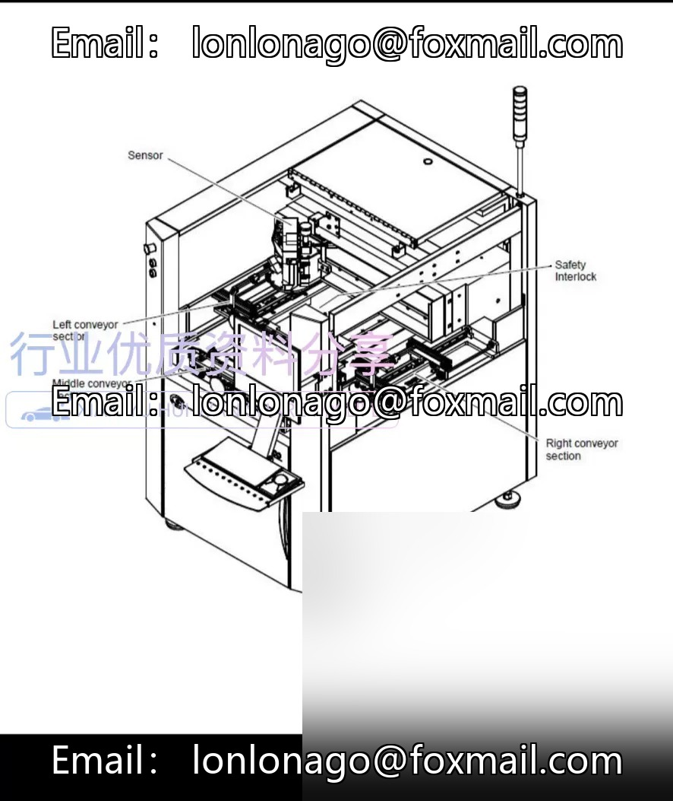
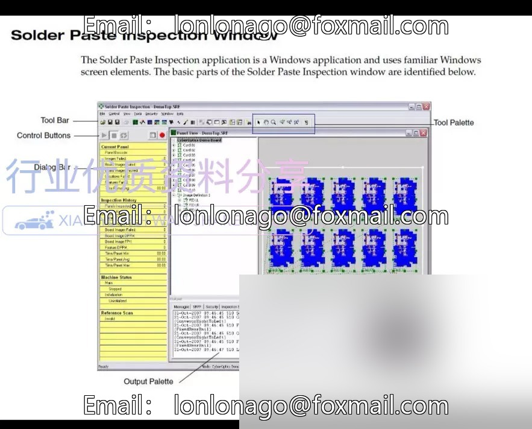
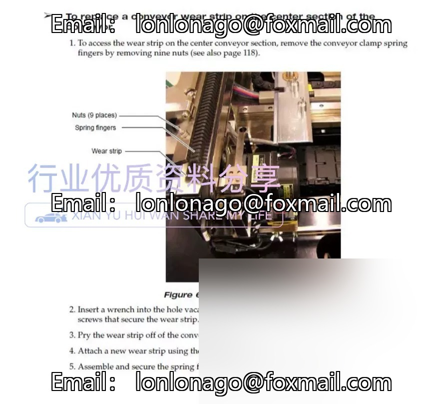
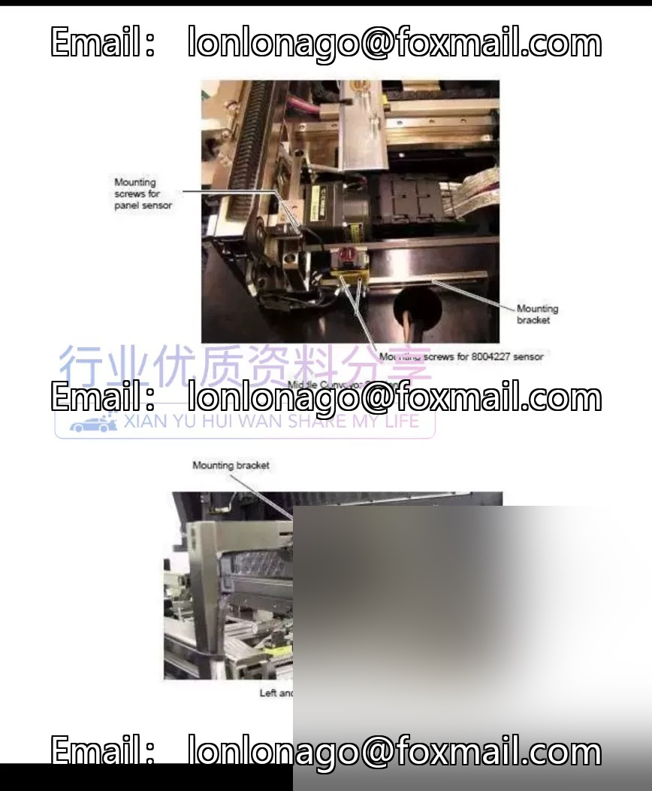
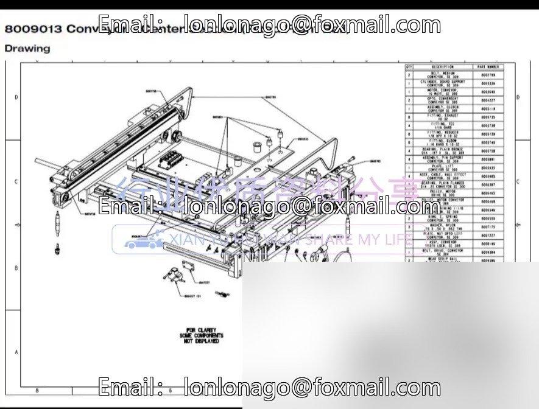
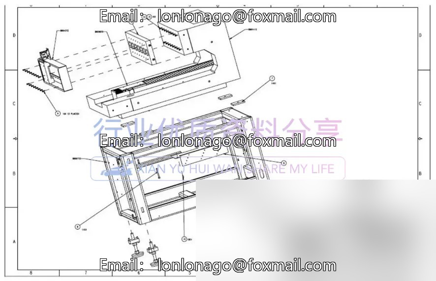
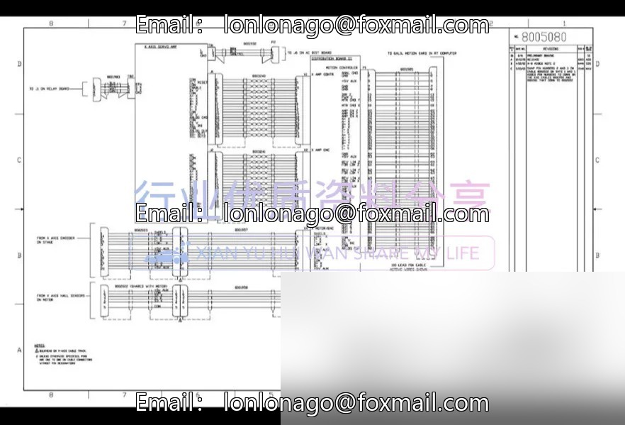

# US Subao SE300 solder paste thickness detection machine technical data, with comprehensive content, including

## Body

American Suibo SE300 solder paste thickness testing machine technical materials The materials contain detailed content Including equipment structural description Operation and maintenance methods Mechanical assembly drawings and electrical principle diagrams have immense reference value.

The following are screenshots of some content. Capture and send the electronic original directly! Please confirm before placing the order! Due to the copyability of electronic file materials. So after purchasing, it cannot be returned! Thanks for understanding!

The technical content includes device structure descriptions, operation and maintenance methods, mechanical assemblies and electrical principles; the images show sensors, safety features, interlocks, conveyor parts, toolbars, control buttons and related elements.

<!-- AI_ENRICHED -->

## Images

## Payment

Here is a pay link on Stripe ( https://buy.stripe.com/3cs8yP7sY87d0vu9AB ). Please contact me lonlonago@foxmail.com after funding $89, and I will send you a complete data files , thank you!

